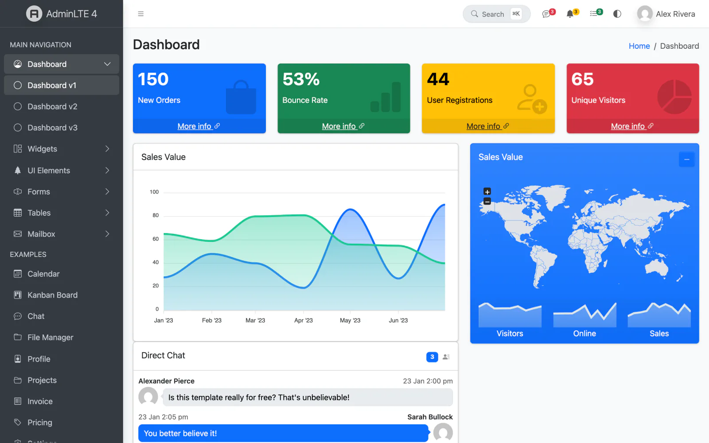

# AdminLTE 4 for ASP.NET Core

[](https://www.nuget.org/packages/ColorlibHQ.AdminLTE.AspNetCore)
[](https://dotnet.microsoft.com/)
[](https://getbootstrap.com/)
[](https://github.com/ColorlibHQ/adminlte-aspnet/blob/main/LICENSE)

Official [AdminLTE 4](https://adminlte.io) integration for ASP.NET Core — **Blazor components** *and* **Tag Helpers** for MVC / Razor Pages, built on Bootstrap 5.3 with vanilla JS (no jQuery).

The compiled AdminLTE, Bootstrap and Bootstrap Icons assets ship inside the package as static web assets, so you just `dotnet add package` and reference them — no npm build step.

**[Live demo](https://aspnet.adminlte.io)** · **[Documentation](https://docs.adminlte.io/aspnet/introduction)** · **[GitHub](https://github.com/ColorlibHQ/adminlte-aspnet)**



## Installation

```bash
dotnet add package ColorlibHQ.AdminLTE.AspNetCore
```

Register the services in `Program.cs` (binds the menu from the `"AdminLte"` config section):

```csharp
using ColorlibHQ.AdminLTE.AspNetCore;

builder.Services.AddAdminLte(builder.Configuration);
builder.Services.AddHttpContextAccessor(); // needed for the sidebar Tag Helper's active state
```

Define the menu in `appsettings.json`:

```json
{
  "AdminLte": {
    "BrandText": "AdminLTE 4",
    "SidebarTheme": "dark",
    "Menu": [
      { "Header": "MAIN NAVIGATION" },
      { "Text": "Dashboard", "Url": "/", "Icon": "bi bi-speedometer" },
      { "Text": "Admin", "Url": "/admin", "Icon": "bi bi-shield-lock", "Policy": "RequireAdmin" }
    ]
  }
}
```

## Usage — Blazor

Reference the bundled CSS/JS in `App.razor` and wrap pages in `DashboardLayout`:

```razor
@* App.razor <head> *@
<AdminLteStyles />
@* …before </body>, after blazor.web.js *@
<AdminLteScripts />
```

```razor
@* MainLayout.razor *@
@inherits LayoutComponentBase
<DashboardLayout>
    @Body
</DashboardLayout>
```

```razor
@page "/"
<AppContent Title="Dashboard">
    <SmallBox Theme="primary" Title="150" Text="New Orders" Icon="bi-bag-fill" Url="/orders" />
    <Card Title="Monthly Recap" Theme="primary" Variant="outline" Collapsible="true">
        <Progress Value="80" Theme="success" ShowLabel="true" />
        <Button Theme="primary" Icon="bi-download" Label="Export" />
    </Card>
</AppContent>
```

## Usage — MVC / Razor Pages

```cshtml
@addTagHelper *, ColorlibHQ.AdminLTE.AspNetCore

<adminlte-styles />
<adminlte-sidebar />
<adminlte-card title="Monthly Recap" theme="primary" variant="outline">
    <adminlte-progress value="80" theme="success" show-label="true" />
</adminlte-card>
<adminlte-scripts />
```

## What's included

- **Two rendering models from one package** — Blazor components (Server & WebAssembly) and Tag Helpers for MVC / Razor Pages.
- **All 11 layout components** — DashboardLayout, AuthLayout, AppContent, Topbar, Sidebar, SidebarBrand, SidebarNav, SidebarNavItem, SidebarOverlay, Footer, ColorModeToggle, plus the NavMessages, NavNotifications and NavTasks dropdowns.
- **Widgets** — Card, SmallBox, InfoBox, Alert, Callout, Progress, ProgressGroup, Ratings, Timeline, Breadcrumb, ProfileCard, DescriptionBlock, DirectChat, Tabs and Accordion.
- **Form components** — Button, Input, Select, Textarea, InputSwitch, all supporting `@bind-Value` inside `EditForm`.
- **Config-driven sidebar menu** — a strongly-typed `MenuItem` model bound from `appsettings.json`, with authorization policy/role support and automatic active-item highlighting.
- **Light / dark / auto colour mode** — persisted to `localStorage`, with a blocking script so there is no flash of the wrong theme.
- **Command palette** — searches your authorized menu, opens with Cmd/Ctrl+K.
- **Bundled static web assets** — AdminLTE 4, Bootstrap 5.3.8 and Bootstrap Icons served from `/_content/ColorlibHQ.AdminLTE.AspNetCore/…`.

## Requirements

- .NET 10.0 or later
- ASP.NET Core (Blazor Server/WebAssembly, MVC or Razor Pages)

## License

MIT — see [LICENSE](https://github.com/ColorlibHQ/adminlte-aspnet/blob/main/LICENSE). The full documentation, component reference and source live on [GitHub](https://github.com/ColorlibHQ/adminlte-aspnet).
