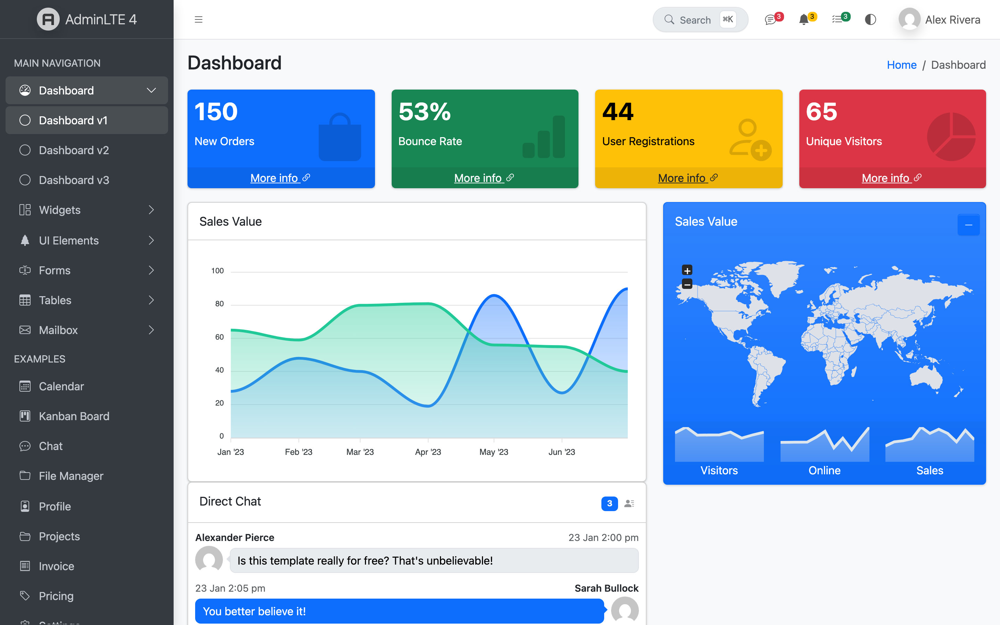

# AdminLTE 4 for ASP.NET Core

[](https://www.nuget.org/packages/ColorlibHQ.AdminLTE.AspNetCore)
[](https://dotnet.microsoft.com/)
[](https://getbootstrap.com/)
[](LICENSE)

Official [AdminLTE 4](https://adminlte.io) integration for ASP.NET Core — **Blazor components** *and* **Tag Helpers** for MVC / Razor Pages, built on Bootstrap 5.3 with vanilla JS (no jQuery). The compiled AdminLTE, Bootstrap and Bootstrap Icons assets ship inside the package as static web assets, so consumers just `dotnet add package` and reference them.

<p align="center">
  <a href="https://aspnet.adminlte.io"><strong>🔗 Live demo →</strong></a>
  &nbsp;·&nbsp;
  <a href="https://docs.adminlte.io/aspnet/introduction"><strong>📚 Documentation →</strong></a>
  &nbsp;·&nbsp;
  <a href="#installation"><strong>Get started →</strong></a>
</p>

## Also available for your stack

The same AdminLTE 4 dashboard, in the framework you know best — you're looking at the **ASP.NET Core** edition:

<!-- ADMINLTE-ECOSYSTEM:START -->
<div align="center">
  <a href="https://github.com/ColorlibHQ/AdminLTE"></a>
  <a href="https://github.com/ColorlibHQ/adminlte-react"></a>
  <a href="https://github.com/ColorlibHQ/adminlte-react"></a>
  <a href="https://github.com/ColorlibHQ/adminlte-vue"></a>
  <a href="https://github.com/ColorlibHQ/adminlte-vue"></a>
  <a href="https://github.com/ColorlibHQ/adminlte-angular"></a>
  <a href="https://github.com/ColorlibHQ/adminlte-laravel"></a>
  <a href="https://github.com/ColorlibHQ/adminlte-symfony"></a>
  <a href="https://github.com/ColorlibHQ/adminlte-django"></a>
  <a href="https://github.com/ColorlibHQ/adminlte-aspnet"></a>
  <a href="https://github.com/ColorlibHQ/adminlte-drupal"></a>
  <a href="https://docs.adminlte.io"></a>
</div>
<!-- ADMINLTE-ECOSYSTEM:END -->

<p align="center">
  <a href="https://aspnet.adminlte.io"></a>
</p>


> Also available as the original [AdminLTE](https://github.com/ColorlibHQ/AdminLTE) (HTML · Bootstrap 5.3 · vanilla JS — [demo](https://adminlte.io/themes/v4/)) and the legacy [AdminLTE v3](https://github.com/ColorlibHQ/AdminLTE/tree/v3) (Bootstrap 4 · jQuery).

## What's included

- **Two rendering models from one NuGet package:**
  - **Blazor components** (Server & WebAssembly, interactive render modes) — `<DashboardLayout>`, `<Card>`, `<SmallBox>`, `<EditForm>`-friendly inputs, and more.
  - **Tag Helpers** for MVC / Razor Pages — `<adminlte-sidebar>`, `<adminlte-card>`, `<adminlte-small-box>`, `<adminlte-info-box>`, `<adminlte-alert>`, `<adminlte-callout>`, `<adminlte-progress>`, `<adminlte-timeline>`, `<adminlte-breadcrumb>`, `<adminlte-profile-card>`, `<adminlte-description-block>`, `<adminlte-styles>`, `<adminlte-scripts>`.
- **All 11 layout components** — DashboardLayout, AuthLayout, AppContent, Topbar, Sidebar, SidebarBrand, SidebarNav, SidebarNavItem, SidebarOverlay, Footer, ColorModeToggle, plus the topbar dropdowns NavMessages, NavNotifications and NavTasks.
- **Widgets** — Card, SmallBox, InfoBox, Alert, Callout, Progress, ProgressGroup, Ratings, Timeline, Breadcrumb, ProfileCard, DescriptionBlock, DirectChat, Tabs/Tab and Accordion/AccordionItem.
- **Priority form components** — Button, Input, Select, Textarea, InputSwitch (all support `@bind-Value` inside `EditForm`).
- **Config-driven sidebar menu** — a strongly-typed `MenuItem` model bound from `appsettings.json` via the Options pattern (text, route/href, icon, badge, submenu, **authorization policy / role**), with automatic active-item highlighting.
- **Light / dark / auto color mode** — persisted to `localStorage`, with a server-respecting blocking script so there's **no flash of the wrong theme** on first paint.
- **⌘K command palette** — searches your (authorized) menu; opens via the topbar pill or Cmd/Ctrl+K.
- **Bundled static web assets** — compiled AdminLTE 4, Bootstrap 5.3.8 and Bootstrap Icons served from `/_content/ColorlibHQ.AdminLTE.AspNetCore/…`. No npm build step required by consumers.

## Requirements

- **.NET 10 SDK** (ASP.NET Core 10) or later
- A Blazor Web App, MVC, or Razor Pages project

## Installation

```bash
dotnet add package ColorlibHQ.AdminLTE.AspNetCore
```

Register the services in `Program.cs` (binds the menu from the `"AdminLte"` config section):

```csharp
using ColorlibHQ.AdminLTE.AspNetCore;

builder.Services.AddAdminLte(builder.Configuration);
builder.Services.AddHttpContextAccessor(); // needed for the sidebar Tag Helper's active state
```

Define the menu in `appsettings.json`:

```json
{
  "AdminLte": {
    "BrandText": "AdminLTE 4",
    "SidebarTheme": "dark",
    "Menu": [
      { "Header": "MAIN NAVIGATION" },
      { "Text": "Dashboard", "Url": "/", "Icon": "bi bi-speedometer" },
      {
        "Text": "Widgets", "Icon": "bi bi-grid-1x2", "Badge": "New", "BadgeColor": "primary",
        "Children": [
          { "Text": "Cards", "Url": "/widgets/cards", "Icon": "bi bi-circle" },
          { "Text": "Small Boxes", "Url": "/widgets/small-boxes", "Icon": "bi bi-circle" }
        ]
      },
      { "Text": "Admin", "Url": "/admin", "Icon": "bi bi-shield-lock", "Policy": "RequireAdmin" }
    ]
  }
}
```

## Usage — Blazor

Reference the bundled CSS/JS in your `App.razor` and wrap pages in `DashboardLayout`:

```razor
@* App.razor <head> *@
<AdminLteStyles />
@* …before </body>, after blazor.web.js *@
<AdminLteScripts />
```

```razor
@* MainLayout.razor *@
@inherits LayoutComponentBase
<DashboardLayout>
    @Body
</DashboardLayout>
```

```razor
@* A page *@
@page "/"
<AppContent Title="Dashboard">
    <div class="row">
        <div class="col-lg-3 col-6">
            <SmallBox Theme="primary" Title="150" Text="New Orders" Icon="bi-bag-fill" Url="/orders" />
        </div>
    </div>
    <Card Title="Monthly Recap" Theme="primary" Variant="outline" Collapsible="true">
        <Progress Value="80" Theme="success" ShowLabel="true" />
        <Button Theme="primary" Icon="bi-download" Label="Export" />
    </Card>
</AppContent>
```

Forms bind two-way inside an `EditForm`:

```razor
<EditForm Model="_model" OnValidSubmit="Submit">
    <Input Label="Email" Type="email" @bind-Value="_model.Email" Prepend="@@" />
    <Select Label="Department" @bind-Value="_model.Department" Options="_departments" />
    <InputSwitch Label="Subscribe" @bind-Value="_model.Subscribe" />
    <Button Type="submit" Theme="primary" Label="Send" />
</EditForm>
```

## Usage — MVC / Razor Pages (Tag Helpers)

Register the Tag Helpers in `Views/_ViewImports.cshtml`:

```cshtml
@addTagHelper *, ColorlibHQ.AdminLTE.AspNetCore
```

Then in your layout / views:

```cshtml
<head>
    <adminlte-styles />
</head>
<body class="layout-fixed sidebar-expand-lg bg-body-tertiary">
    <div class="app-wrapper">
        <nav class="app-header navbar navbar-expand bg-body">
            <ul class="navbar-nav ms-auto"><adminlte-color-mode-toggle /></ul>
        </nav>

        <adminlte-sidebar />

        <main class="app-main">
            <div class="app-content"><div class="container-fluid">
                <adminlte-small-box title="150" text="New Orders" icon="bi-bag-fill" theme="primary" url="/orders" />
                <adminlte-card title="Welcome" theme="primary" variant="outline">…</adminlte-card>
            </div></div>
        </main>
    </div>
    <adminlte-scripts />
</body>
```

A full MVC layout + view sample lives in [`docs/mvc-usage/`](docs/mvc-usage/).

## Components

| Category | Components |
|----------|------------|
| **Layout (Blazor)** | `DashboardLayout`, `AuthLayout`, `AppContent`, `Topbar`, `Sidebar`, `SidebarBrand`, `SidebarNav`, `SidebarNavItem`, `SidebarOverlay`, `Footer`, `ColorModeToggle`, `CommandPalette`, `NavMessages`, `NavNotifications`, `NavTasks` |
| **Widgets (Blazor)** | `Card`, `SmallBox`, `InfoBox`, `Alert`, `Callout`, `Progress`, `ProgressGroup`, `Ratings`, `Timeline`, `Breadcrumb`, `ProfileCard`, `DescriptionBlock`, `DirectChat`, `Tabs`/`Tab`, `Accordion`/`AccordionItem` |
| **Forms (Blazor)** | `Button`, `Input`, `Select`, `Textarea`, `InputSwitch` |
| **Tag Helpers (MVC)** | `<adminlte-styles>`, `<adminlte-scripts>`, `<adminlte-sidebar>`, `<adminlte-color-mode-toggle>`, `<adminlte-card>`, `<adminlte-small-box>`, `<adminlte-info-box>`, `<adminlte-alert>`, `<adminlte-callout>`, `<adminlte-progress>`, `<adminlte-timeline>`, `<adminlte-breadcrumb>`, `<adminlte-profile-card>`, `<adminlte-description-block>` |

## Demo

A runnable Blazor Web App that dogfoods the library lives in [`samples/AdminLte.Demo`](samples/AdminLte.Demo):

```bash
dotnet run --project samples/AdminLte.Demo
```

Then open the printed `https://localhost:7080` URL. It shows the dashboard (small boxes, info boxes, cards, timeline), a forms page, a profile page, and a login page using `AuthLayout`.

## Building from source

```bash
dotnet restore
dotnet build
dotnet run --project samples/AdminLte.Demo   # run the demo
dotnet pack src/ColorlibHQ.AdminLTE.AspNetCore -c Release   # produce the NuGet package
```

## Contributing

Issues and PRs are welcome. Please keep the component API and AdminLTE markup consistent with the other official ports (React, Vue, Laravel, Django, Symfony).

## License

[MIT](LICENSE) © 2014-2026 ColorlibHQ. Built on the [AdminLTE](https://github.com/ColorlibHQ/AdminLTE) admin template.
